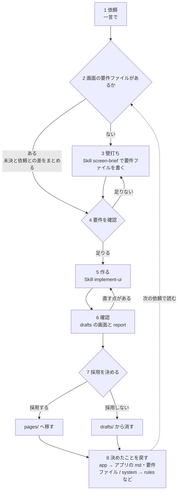

# 画面を生成するまでの流れ（案）

AI に画面を作らせるとき、依頼とドキュメントをどう用意し、生成のあと決めたことをどこに戻すかの流れ。検討中のもので、「今あるか」が「一部」「試作」の段階は仕組みがそろっていない。

## 考え方

- **依頼は一言で済ませる**。Skill の名前を言う必要はない。画面づくりの依頼は Skill `implement-ui` が受け、要件の聞き取り（`screen-brief`）と決めたことの書き戻し（`reflect-decisions`）は、必要なときに `implement-ui` の中から呼ぶ。何度も使う情報はドキュメントに置き、依頼はファイルに残さない。`experiments/prompts/` は検証で条件をそろえるための置き場所で、実際の運用では使わない
- **事実は人が書き、判断は AI に任せる**。AI には知りようがないこと（誰が・どんな場面で使うか、決まっている仕様）は人が書く。そこから導けること（最初に見せる情報、部品の選び方、レイアウト）は AI が判断し、その判断を確かめる
- **アプリの md と画面の要件ファイルは小さく始めて、生成のたびに育てる**。最初から全部を埋めようとしない

## 流れ

## 入口は3つ

| 状況 | 進め方 |
| --- | --- |
| 新しいアプリ | 1 から進める。2 でアプリの md がないと分かったら、3 でアプリの事実と画面の要件を聞き取る |
| 既存アプリの新しい画面 | 1 から進める。2 で画面の要件ファイルがないと分かったら、3 でその画面の要件を聞き取る |
| 既存画面の更新 | 一言の依頼で 1 から進める。2 で AI が未決と依頼との差をまとめ、4 で確かめる。足りなければ 3 で足りない項目だけを聞く |

## 足りない仕組み

目指す流れのうち、今の Skill にない部分と、今試せる流れでの代わりのやり方。

| 段階 | 足りないもの | 今の代わり | 直す場所 |
| --- | --- | --- | --- |
| 3 壁打ち | Skill `screen-brief` は試作のまま。聞く項目と要件ファイルの形が決まっていない | 試作の Skill を使う | Skill `screen-brief` |
| 6 確認 | やり直したとき、前回の推測を引き継いで report を書く手順。今は上書きされて消える | なし | Skill `implement-ui` |
| 7 採用しない | `drafts/` の Story を消す細かい手順（今は「消してから戻す」とだけ書いてある） | AI に「採用しない」と伝える | Skill `implement-ui` |
| 8 戻す | Skill `reflect-decisions` は試作のまま | 試作の Skill を使う（書く前に承認を取る） | Skill `reflect-decisions` |

2（要件ファイルを確かめる）と 5（要件ファイルを読み、未決を推測として記録する）、3 と 8 への引き継ぎは、Skill `implement-ui` に入れた（試作）。

## どこに何を置くか

| 種類 | 例 | 置き場所 |
| --- | --- | --- |
| アプリの事実 | 何のアプリか、誰がどんな場面で使うか | `docs/design/apps/<アプリ名>.md` |
| 画面の一覧 | 画面の名前・パス・目的 | アプリの md の「主な画面」。要件ファイルへリンクする |
| 画面の要件 | 目的、使う人と場面、開き方と移動先、表示と操作（エリアごと）、状態で変わること、こうなると困ること、決まっている文言、未決のこと | `docs/design/apps/<アプリ名>/screens/<画面>.md` |
| 未決のこと | 何週先まで表示するか（画面）、メンバーの並び順の決まり（アプリ全体） | その画面だけのことは要件ファイル、アプリ全体のことはアプリの md の「未決のこと」。決まったら該当する見出しに書き、未決の行を消す |
| アプリ固有の原則・色・部品 | 「今週がすぐわかる」、`status-holiday`、`CTScheduleCard` | アプリの md。最初は空で、8 で育つ |
| 社内アプリ共通のルール | 色・余白・文字・部品・禁止事項、文脈と原則 | `rules.md`、`principles.md`、ガイドライン、共通部品 |
| 進め方・検証・報告 | 読む順番、用意する状態、推測の記録 | Skill `implement-ui`。壁打ちは Skill `screen-brief`、戻すのは Skill `reflect-decisions` |
| その回の依頼 | 作る画面 | 一言で伝える。ファイルには残さない |
| 検証用の依頼文 | reproduce、add-page | `experiments/prompts/`（条件をそろえるために固定する） |

依頼に書きたくなったことがあれば、まず上のどこに置くかを考える。

## 育ち方

| 項目 | 壁打ちで書く | 生成を重ねて足す |
| --- | --- | --- |
| 何のアプリか、ユーザーと利用シーン | ○ | ずれが見つかれば足す |
| 主な画面と目的 | ○ | 画面が増えるたびに足す |
| 画面の要件 | 決まっている分だけ。決まらないことは「未決」 | 推測を決めて足す、未決を埋める（文言、並び順、空状態など） |
| このアプリ固有の原則 | | `context` のずれから足す |
| このアプリ固有の色・部品 | | 繰り返し出てきたら足す |
| Story で用意する状態 | | 推測から足す |

## 検討すること

- **壁打ちの Skill**: `screen-brief` を試作した。聞く項目、聞かないこと、要件ファイルの形を見直す
- **`system` の決めごとを誰が承認するか**: Skill `reflect-decisions` は今、その場の人の承認だけで `rules.md` や Skill に書き込む。`system` はその場で書かず、DS 担当に確認する候補として報告に回すかを相談して決める
- **検証の分け方**: 生成だけを見る検証（要件ファイルを先に用意し、依頼は一言）と、壁打ちを見る検証（要件ファイルなしで始める）に分けるか。md を最小版に削った「1日目の状態」でも回すか
